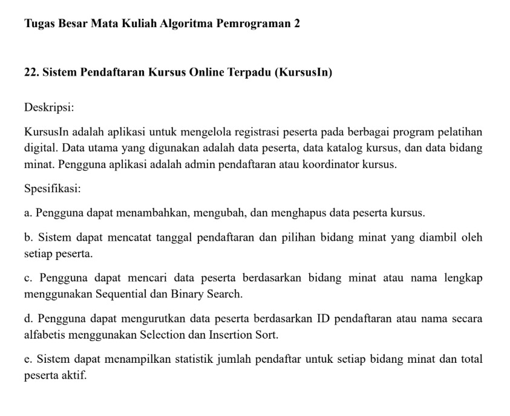

# KursusIn: Sistem Pendaftaran Kursus Online Terpadu

Aplikasi *Command Line Interface* (CLI) berbasis **Go (Golang)** untuk mengelola registrasi peserta pelatihan digital, katalog kursus, dan bidang minat. Proyek ini mengimplementasikan algoritma pencarian (*Sequential Search* & *Binary Search*) serta pengurutan (*Selection Sort* & *Insertion Sort*) di atas struktur array statis tanpa dependensi pihak ketiga.

---

## Daftar Isi

- [Ringkasan Arsitektur](#ringkasan-arsitektur)
- [Spesifikasi Sistem](#spesifikasi-sistem)
- [Struktur Data & Relasi Entitas](#struktur-data--relasi-entitas)
- [Implementasi & Kompleksitas Algoritma](#implementasi--kompleksitas-algoritma)
- [Validasi Input](#validasi-input)
- [Struktur Menu & Contoh Tampilan CLI](#struktur-menu--contoh-tampilan-cli)
- [Cara Menjalankan & Pengujian](#cara-menjalankan--pengujian)
- [Tim Pengembang](#tim-pengembang)

---

## Ringkasan Arsitektur

- **Pemrograman Prosedural Murni**: Seluruh logika dipecah ke dalam subprogram/fungsi modular dengan pengiriman parameter *by value* dan *by reference* (pointer `*tabPeserta`, `*tabKursus`, `*tabBidang`).
- **Tanpa Library Eksternal**: Hanya menggunakan paket standar `fmt` untuk interaksi I/O dan dibangun sesuai aturan struktur kontrol terstruktur (tanpa `break` paksa di tengah perulangan pencarian).
- **Integritas Relasional Otomatis**: Setiap `Kursus` terhubung ke satu `BidangMinat`, dan setiap `Peserta` yang memilih `idKursus` otomatis mewarisi `idBidang` dari kursus tersebut.

---

## Spesifikasi Sistem

Berdasarkan spesifikasi Tugas Besar Algoritma dan Pemrograman 2 (Soal Nomor 22):

| Kode | Spesifikasi Fungsional | Implementasi |
| :--- | :--- | :--- |
| **a** | Menambahkan, mengubah, dan menghapus data peserta kursus. | `tambahDataPeserta`, `ubahDataPeserta`, `hapusDataPeserta`, `tampilDataPeserta` |
| **b** | Mencatat tanggal pendaftaran dan pilihan bidang minat setiap peserta. | Validasi `DD-MM-YYYY` + resolusi otomatis `idBidang` via `ambilIdBidangDariKursus` |
| **c** | Mencari data peserta berdasarkan bidang minat atau nama lengkap. | *Sequential Search* (`cariPesertaBidang`) & *Binary Search* (`cariPesertaNama`) |
| **d** | Mengurutkan data peserta berdasarkan ID pendaftaran atau nama secara alfabetis. | *Selection Sort* (`urutIDPesertaAscending/Descending`) & *Insertion Sort* (`urutNamaPesertaAscending/Descending`) |
| **e** | Menampilkan statistik jumlah pendaftar per bidang minat, per kursus, dan total peserta aktif. | `statistikPeserta` (menghitung distribusi jumlah dan persentase) |

<details>
<summary>Lihat Dokumen Soal Asli (Dokumentasi-KursusIn.jpeg)</summary>



</details>

---

## Struktur Data & Relasi Entitas

Program menggunakan array statis berkapasitas `NMAX = 1000` untuk menjaga alokasi memori tetap terprediksi:

```go
const NMAX = 1000

type Peserta struct {
    idPendaftaran int    // ID unik peserta (> 0)
    namaLengkap   string // Nama peserta (minimal mengandung 1 huruf)
    tanggalDaftar string // Format: DD-MM-YYYY
    idKursus      int    // Foreign key ke Kursus.idKursus
    idBidang      int    // Terisi otomatis dari Kursus.idBidang
    statusAktif   bool   // true = Aktif, false = Tidak Aktif
}

type Kursus struct {
    idKursus   int
    namaKursus string
    idBidang   int // Foreign key ke BidangMinat.idBidang
}

type BidangMinat struct {
    idBidang   int
    namaBidang string
}

type tabPeserta [NMAX]Peserta
type tabKursus  [NMAX]Kursus
type tabBidang  [NMAX]BidangMinat
```

### Skema Relasi

```text
BidangMinat (1) ──────< (N) Kursus (1) ──────< (N) Peserta
  [idBidang]             [idKursus]             [idPendaftaran]
                         [idBidang] ──────────> [idBidang (Auto)]
```

---

## Implementasi & Kompleksitas Algoritma

| Fitur | Algoritma | Kompleksitas Waktu | Kompleksitas Ruang | Catatan Teknis |
| :--- | :--- | :--- | :--- | :--- |
| **Urut ID Peserta (Asc / Desc)** | *Selection Sort* | $\mathcal{O}(n^2)$ | $\mathcal{O}(1)$ | Mencari indeks nilai ekstrem pada tiap *pass* dan melakukan pertukaran (*in-place swap*). |
| **Urut Nama Peserta (A-Z / Z-A)** | *Insertion Sort* | $\mathcal{O}(n^2)$ terburuk, $\mathcal{O}(n)$ terbaik | $\mathcal{O}(1)$ | Menyisipkan elemen ke posisi terurut secara leksikografis (*in-place*). |
| **Cari Peserta per Bidang Minat** | *Sequential Search* | $\mathcal{O}(n)$ | $\mathcal{O}(1)$ | Menelusuri seluruh elemen dari indeks `0` hingga `n-1` untuk menampilkan semua peserta yang cocok. |
| **Cari Peserta per Nama Lengkap** | *Insertion Sort* + *Binary Search* | $\mathcal{O}(n^2)$ pra-urut + $\mathcal{O}(\log n)$ pencarian | $\mathcal{O}(n)$ | Menyalin data ke array sementara `temp` agar urutan asli tidak berubah, lalu melakukan ekspansi kiri-kanan dari indeks `tengah` untuk menangkap nama yang duplikat. |

---

## Validasi Input

Seluruh pembacaan input dilindungi oleh loop validasi (`for !valid`) agar data yang masuk ke array selalu konsisten:

| Fungsi | Aturan Validasi |
| :--- | :--- |
| `validasiIDPositif` | Menolak bilangan $\le 0$. |
| `validasiNama` | Menolak input kosong atau input yang hanya berisi angka/simbol tanpa huruf (`a-z`, `A-Z`). |
| `validasiTanggal` | Memastikan panjang tepat 10 karakter dengan format `DD-MM-YYYY`, karakter pemisah `-` pada indeks ke-2 dan ke-5, serta digit numerik pada posisi tanggal, bulan, dan tahun. |
| `validasiStatusAktif` | Hanya menerima literal `"true"` atau `"false"`. |
| `cekIdBidang`, `cekIdKursus`, `cekIdPeserta` | Menjamin keunikan primary key saat penambahan data serta memvalidasi keberadaan foreign key sebelum relasi dibuat. |

---

## Struktur Menu & Contoh Tampilan CLI

### Hierarki Menu

```text
MENU UTAMA KURSUSIN
├── 1. Data Peserta
│   ├── 1. Kelola Data (Tambah / Ubah / Hapus / Tampil)
│   ├── 2. Urutkan Data (ID Asc, ID Desc, Nama A-Z, Nama Z-A)
│   ├── 3. Cari Data (Berdasarkan Bidang Minat / Nama Lengkap)
│   ├── 4. Statistik Peserta
│   └── 5. Kembali ke Menu Utama
├── 2. Data Kursus (Tambah / Tampil)
├── 3. Data Bidang Minat (Tambah / Tampil)
└── 4. Keluar
```

### Contoh Sesi Terminal

```text
======= MENU UTAMA KURSUSIN =======
  1. Data Peserta
  2. Data Kursus
  3. Data Bidang Minat
  4. Keluar
-----------------------------------
Pilihan : 1

--- Tambah Data Peserta ---
ID Pendaftaran              : 101
Nama Lengkap                : Andi_Pratama
Tanggal Daftar (DD-MM-YYYY) : 15-05-2026
ID Kursus                   : 10
  ID Bidang (otomatis)        : 1
Status Aktif (true/false)   : true
[v] Data peserta berhasil ditambahkan.

======= STATISTIK PESERTA =======
  Total Peserta Terdaftar      : 3
  Total Peserta Aktif          : 2 (66.67%)
  Total Peserta Tidak Aktif    : 1 (33.33%)

  -- Distribusi per Bidang Minat --
  Backend_Engineering  : 2 peserta (66.67%)
  UI_UX_Design         : 1 peserta (33.33%)

  -- Distribusi per Kursus --
  Golang_Fundamental   : 2 peserta (66.67%)
  Figma_Design_System  : 1 peserta (33.33%)
---------------------------------
```

---

## Cara Menjalankan & Pengujian

### 1. Menjalankan Aplikasi

Pastikan **Go (1.18+)** sudah terpasang, kemudian jalankan:

```bash
git clone https://github.com/dpndri/kursus-in.git
cd kursus-in
go run main.go
```

Atau kompilasi menjadi binary executable:

```bash
go build -o kursusin main.go
./kursusin
```

> **Urutan Pengisian Data Awal**: Tambahkan **Data Bidang Minat** (Menu 3) terlebih dahulu, dilanjutkan **Data Kursus** (Menu 2), baru kemudian **Data Peserta** (Menu 1).

### 2. Menjalankan Unit Test

Repositori ini dilengkapi unit test pada `main_test.go` untuk memverifikasi fungsi pengurutan (*Selection Sort* & *Insertion Sort*), pencarian indeks, dan resolusi relasi:

```bash
go test -v ./...
```

---

## Tim Pengembang

Proyek ini dikembangkan oleh:

- **Muhammad Irgie Dapiandri** ([@dpndri](https://github.com/dpndri))
- **Angga Yudhistira**
